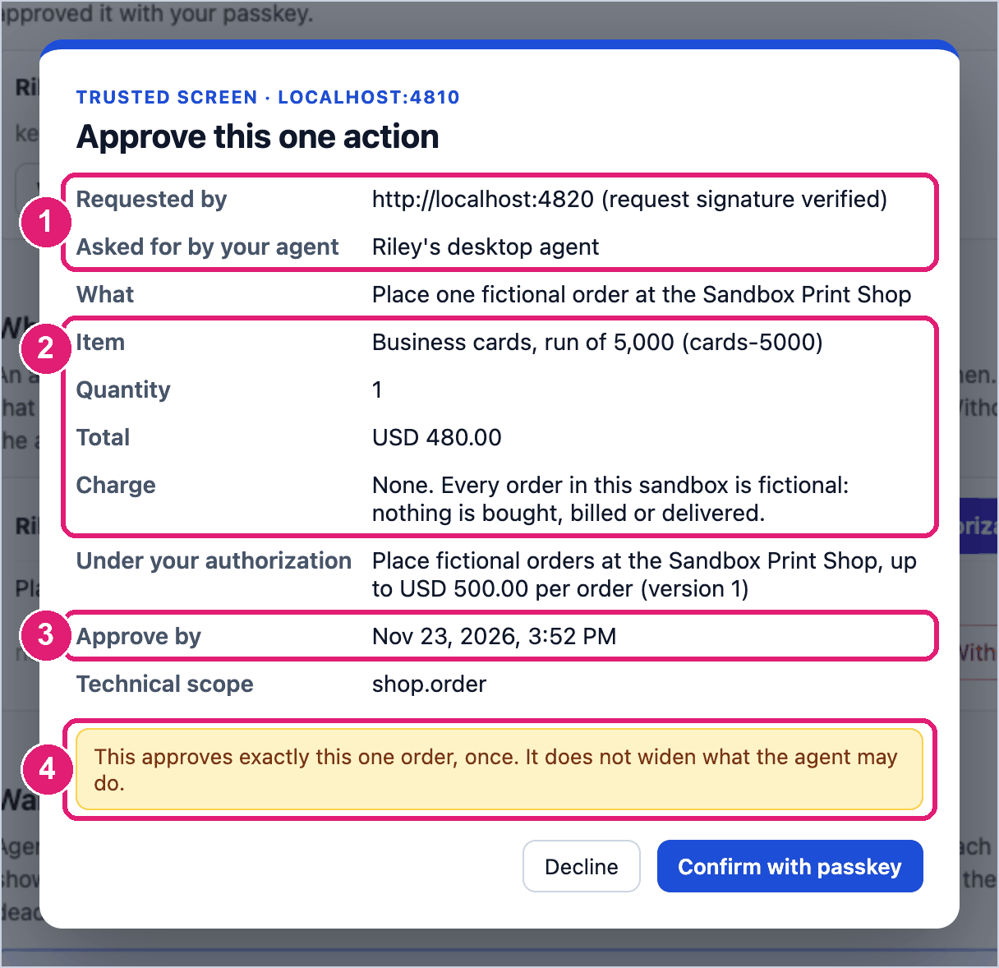
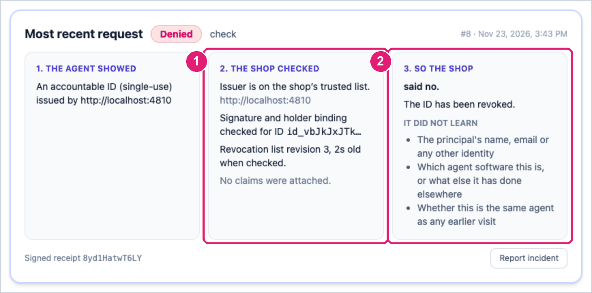

# Accountable Agents Framework reference implementation

**The AAF pilot is live on the web for testing.** This repository contains the full source code for this open-source reference implementation of *The Accountable Agents Framework (AAF): A Blueprint for AI Agent IDs*.

**[Open the live Accountable Agents Directory](https://aaf-dir.civics.com/) · [Visit the Sandbox Print Shop](https://aaf-shop.civics.com/) · [Run your own copy](#run-the-services-locally)**

You can browse both sites. **Live enrollment and testing are currently by invitation only** because of bandwidth and compute limits on the hosting provider. With an invitation, you can connect an agent, request a quote, approve one fictional order with a passkey, and revoke the agent. All orders are fictional.

## Get started

**[Open the setup guide](https://aaf-dir.civics.com/setup) · [Download the AAF agent ZIP](https://github.com/dazzaji/AAF_OSFI/releases/download/v0.2.0/aaf-agent-v0.2.0.zip) · [Agent instructions (`/skill.md`)](https://aaf-dir.civics.com/skill.md)**

You need an invitation to the Directory. Open it from your email and create a passkey, saved as a new entry in your password manager. Then connect an agent in one of two ways. Both use the same release ZIP, and neither needs a clone of this repository.

**With a desktop agent** such as Claude Code or Codex, or any agent that can run commands: on the [Directory home page](https://aaf-dir.civics.com/), press **Copy for my agent** and paste the message into a new local session. The agent reads its instructions, tells you what it will install and where, and asks for your go-ahead. It then downloads the ZIP, checks its SHA-256, and asks the Directory to register it. You compare the pairing code, approve with your passkey in the browser, tell the agent you approved, and it gets a fictional **$38** quote. You type no Terminal commands.

**From the command line**, with Node.js 22.13 or later:

```bash
curl -fL -o aaf-agent-v0.2.0.zip https://github.com/dazzaji/AAF_OSFI/releases/download/v0.2.0/aaf-agent-v0.2.0.zip
shasum -a 256 aaf-agent-v0.2.0.zip        # Linux: sha256sum aaf-agent-v0.2.0.zip
unzip -q aaf-agent-v0.2.0.zip
cd aaf-agent
node aaf-agent.mjs version
node aaf-agent.mjs init https://aaf-dir.civics.com --shop https://aaf-shop.civics.com
node aaf-agent.mjs register --name "My command-line agent" --harness cli
# Approve in the browser: check the code and fingerprint, then confirm with your passkey.
node aaf-agent.mjs register --wait 90
node aaf-agent.mjs status
node aaf-agent.mjs quote cards-500
```

The ZIP's SHA-256 is `cb780f3a985fb7dc0ef6484bba43ee1b375feb365ec99a39965555cfe8b2ac8d`. It is also published in the [release notes](https://github.com/dazzaji/AAF_OSFI/releases/tag/v0.2.0) and in the Directory's `/skill.md`. The ZIP holds the client (bundled, so there is no `npm install`), the same client as a local MCP server, the agent skill, a readme, the license and notices. **Verified from a fresh setup, message or quickstart to first quote:** the command line, a headless Claude Code session, and a headless Codex session, each on macOS with test passkeys. **Pending verification:** the permission prompts of the Claude and Codex desktop apps. The [setup guide](https://aaf-dir.civics.com/setup#ready) says how each was run.

## See the demo

| Walkthrough | Read | Present or edit |
| --- | --- | --- |
| **Claude Code · nine illustrated scenes** | [Read on GitHub](demo/claude/WALKTHROUGH.md) · [PDF](demo/claude/aaf-illustrated-walkthrough.pdf) | [PowerPoint](demo/claude/aaf-illustrated-walkthrough.pptx) · [Slide preview](demo/claude/aaf-illustrated-walkthrough-slides.pdf) · [Word](demo/claude/aaf-illustrated-walkthrough.docx) |
| **Codex · illustrated guide and short slide deck** | [Demo overview](demo/codex/README.md) · [PDF](demo/codex/aaf-illustrated-walkthrough.pdf) | [PowerPoint](demo/codex/aaf-illustrated-walkthrough.pptx) · [Word](demo/codex/aaf-illustrated-walkthrough.docx) |

| Approve one exact order in the Directory | See the Shop reject a revoked ID |
| --- | --- |
|  |  |

The Claude Code walkthrough was rebuilt on version 0.2.0. Its screenshots are from a local rehearsal with a synthetic account and test passkeys, and they show the setup strip, **Copy for my agent** and the setup guide that version 0.2.0 added ([sprint notes](https://github.com/dazzaji/AAF_OSFI/issues/3)).

## Try the hosted pilot

Use the **Design** menu to switch between Story and Console. Both sites show live records. The Shop’s live decision history is available to its administrator. Each header has **View source on GitHub**, and the Directory header has **Setup guide**.

1. Open the Directory invitation from your inbox and create a passkey. Redeeming an emailed invitation demonstrates control of that mailbox.
2. [Connect your agent](#get-started): press **Copy for my agent** on the Directory and paste the message into a local desktop agent session, or use the command-line quickstart. Compare the pairing code and key fingerprint shown by the agent and in the Directory, then confirm with your passkey.
3. Ask **“Get a quote from the Sandbox Shop for 500 business cards.”** The Shop checks a short-lived ID issued by the Directory and returns a fictional **$38** quote.
4. Ask for a fictional order for **5,000 business cards**. The Shop asks for authorization and requires your approval of this exact **$480** order. Review the Directory confirmation and approve with your passkey, then ask the agent to continue.
5. In the Directory, withdraw the ordering permission or revoke the agent. Withdrawing the permission blocks new orders that require it. Revoking the agent stops the Directory from issuing it new IDs.

The pilot also shows how a Shop can report a transaction using its signed receipt. In a simulated release process, an authorized operator can trace that receipt to the principal, who receives a notice. See the [Appendix A conformance notes](docs/CONFORMANCE.md) for what the pilot demonstrates and where it is partial. This is a sandbox for exploring the framework. All orders are fictional.

## Connect a desktop agent

The [setup guide](https://aaf-dir.civics.com/setup) is the place to start. The agent client holds the agent's signing key. You keep the passkey used to approve, grant, and revoke in the Directory.

The message you copy from the Directory tells the agent to read [`/skill.md`](skill/aaf-agent/SKILL.md), which the Directory serves with the pinned download address and SHA-256. The skill has the agent install the release ZIP as a skill folder (`~/.claude/skills/aaf-agent` for Claude Code, `~/.agents/skills/aaf-agent` for Codex) and keep its key in its own profile folder. Your app may ask you to allow a download, writing those folders, running `node`, and opening a browser tab.

### Local MCP server

The ZIP also contains the same client as a local MCP server, `aaf-agent-mcp.mjs`. Configure the desktop app to launch it over stdio with `node /absolute/path/to/aaf-agent/aaf-agent-mcp.mjs`. This is useful when the desktop session's shell cannot write the agent's profile folder. Initialize the client for the same profile first:

```bash
node aaf-agent.mjs init https://aaf-dir.civics.com --shop https://aaf-shop.civics.com
```

Use `init --home <folder>` (or `AAF_AGENT_HOME`) to give each app, or each Directory, its own profile. From a clone of this repository the same commands are `node src/agent/cli.js ...` after `npm ci`, and `npm run agent-zip` rebuilds the ZIP byte for byte.

## The three parts

| Part | What it does | Code |
|---|---|---|
| **Directory** | Enrolls people, registers agents, issues IDs and claims, records passkey approvals, publishes revocations, and can trace an ID under a stated process. | [Directory source](src/directory/) |
| **Sandbox Shop** | Checks the agent's presentation against a trusted Directory's published keys and status list, applies its access rules, and signs decision receipts. | [Shop source](src/shop/) |
| **Agent client** | Holds the agent's key and handles registration, ID requests, and Shop interactions. Use it from a desktop app through the skill or local MCP, or directly from the command line. | [Agent source](src/agent/) |

## Run the services locally

With Node.js 22.13 or later, run the following from the repository root:

```bash
npm ci
npm start
```

Open the [local Directory](http://localhost:4100) and [local Shop](http://localhost:4200) in Chrome or Safari. On the first run, the local Directory prints a one-time link to enroll its operator. Invite a principal from the operator view, then use the desktop walkthrough with the local addresses. Developers can also initialize the client with `node src/agent/cli.js init http://localhost:4100 --shop http://localhost:4200` and run `node src/agent/cli.js help` for commands.

Local invitations appear in the operator's outbox and carry no mailbox assurance. The services and agent run under one user account. For separate hosted services and real email delivery, see [Deploying the pilot](docs/DEPLOYING.md).

## Swappable page designs and sample data

Both web pages have a **Design** menu. The **Data** menu, which swaps live records for a sample dataset, is shown only to the signed-in Directory operator (and on the Shop only when you run it locally). Everyone else, signed in or not, stays on live records, and a link that names a sample opens Live for them.

- A design ("skin") is one React component in `skins/directory/` or `skins/shop/`. Drop a new `.tsx` file in the folder while the service is running and it appears in the menu of every open tab within a few seconds. Save a change and open tabs reload it. No build step, no restart. The contract is in [skins/SkinContract.ts](skins/SkinContract.ts).
- A sample dataset is a JSON file in `datasets/directory/` or `datasets/shop/` with the same shape as live data. It appears in the operator's Data menu next to "Live". Sample data is read-only and cannot affect live state.
- Skins are untrusted. They run in a sandboxed frame with no access to the session, the network, the clipboard or passkeys. Sign-in, the setup strip with **Copy for my agent**, every confirmation screen and every privileged action belong to the page shell.

## What a counterparty checks

For requests that require an agent ID, the Shop checks the presentation against the Directory's published information:

1. the ID names a directory the shop trusts, and is signed by that directory's published key;
2. it was issued for this shop and has not expired;
3. the request is signed by the key the ID is bound to, over the method, path, body, the exact credentials presented, and a single-use nonce the shop issued;
4. the ID, and each claim, is not revoked according to a status list no older than 18 seconds;
5. each claim was issued for this same ID, and who attests it (the directory, or only the agent itself).

See [docs/PROTOCOL.md](docs/PROTOCOL.md) for the message shapes and one annotated exchange.

## Design choices

Each is the simplest option in the paper's Appendix C. The directory states the consequences in its published practices at `/.well-known/aaf-directory`.

| Area | Choice |
|---|---|
| Identity proofing | Control of an email address, by redeeming a single-use link sent to it. Low assurance. |
| Principal authentication | Passkey with user verification. A fresh assertion for every privileged act. |
| Agent authentication | Ed25519 key. Proof of possession at registration, at each issuance and on each request. |
| IDs | Issued on demand, five-minute lifetime, each bound to a fresh key. A stable per-counterparty ID on request. |
| Authorizations | Set by the principal, attested by the directory. Per-action approvals by passkey, attested by the directory. |
| Revocation | Signed status list. Published bound: 30 seconds (10 to publish, 18 accepted age, 2 clock skew). |
| Identity escrow | The directory keeps the map from each issued ID to its agent and principal. |

Known limits: the directory learns which counterparty each ID is for and when; the default single-use IDs carry no stable identifier for the Shop, while the Directory can link its own issuances; one online signing key; no delegation, key rotation, multi-party escrow or legal-person proofing; the lawful-request step is a labelled simulation.

## Deploying

See [docs/DEPLOYING.md](docs/DEPLOYING.md).

## Credits and license

Written for the AAF paper's call for reference implementations. Christian Turner's [accountable-agents-framework](https://github.com/christortheak/accountable-agents-framework) is the fuller reference profile and implementation; this pilot is an independent, deliberately smaller one.

This pilot is licensed under the [Apache License 2.0](LICENSE). See [NOTICE](NOTICE) for copyright and attribution.
