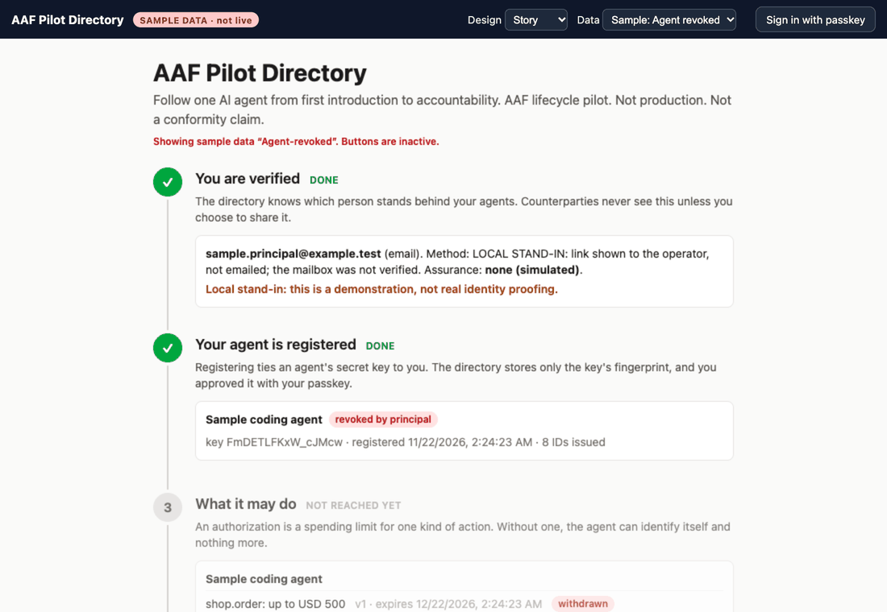
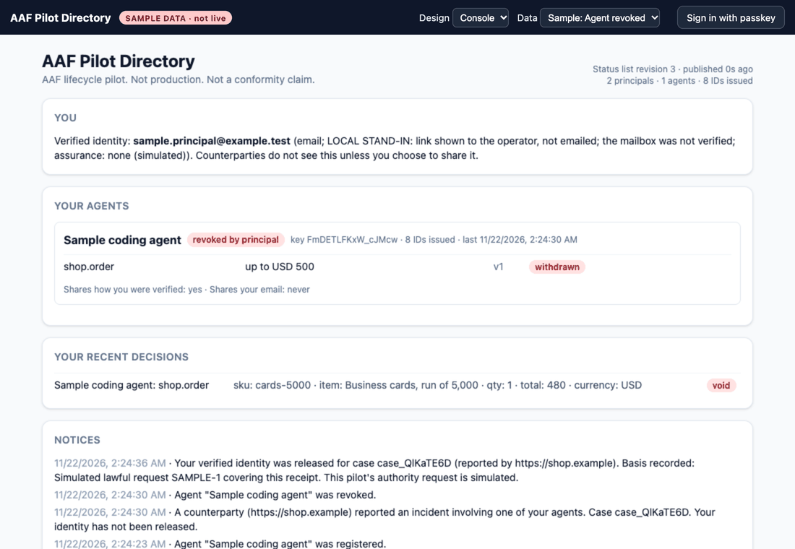
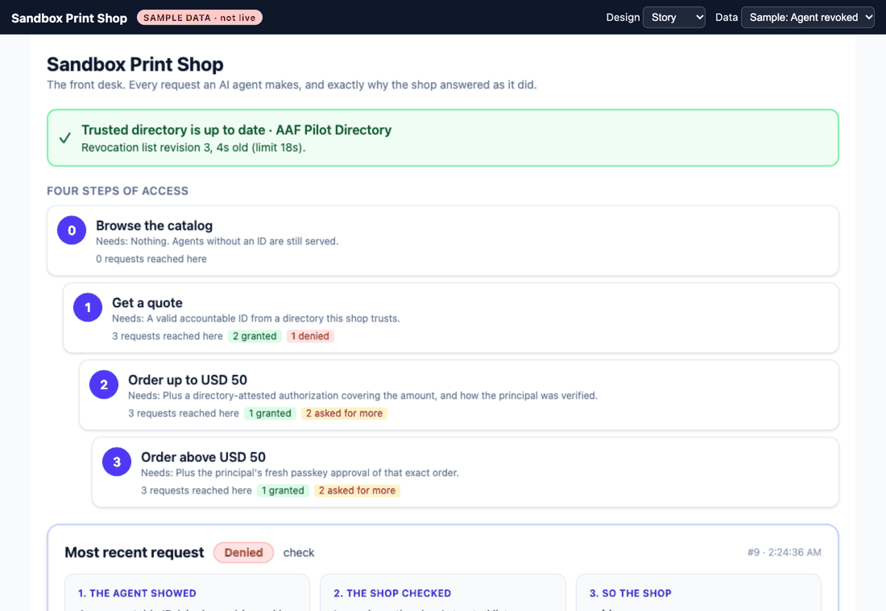

# One agent, one shop, one person in control

**An illustrated walkthrough of the Accountable Agents Framework reference implementation, in seven scenes.**

An AI agent gets an ID. A shop checks it and asks for more when the stakes rise. A person approves one exact order with a passkey, takes a permission back, and then switches the agent off. Each scene shows what really happened on screen.

<table><tr><td align="center" width="25%"><h3><a href="aaf-illustrated-walkthrough.pdf">PDF</a></h3>20 pages, opens in the browser</td><td align="center" width="25%"><h3><a href="aaf-illustrated-walkthrough.docx">Word</a></h3>Editable document</td><td align="center" width="25%"><h3><a href="aaf-illustrated-walkthrough.pptx">PowerPoint</a></h3>42 slides with speaker notes <a href="aaf-illustrated-walkthrough-slides.pdf">preview the slides as PDF</a></td><td align="center" width="25%"><h3><a href="WALKTHROUGH.md">Read it here</a></h3>The same walkthrough in Markdown</td></tr></table>

*Scene 4. The person approves one exact order with a passkey. The trusted screen shows the order as the Shop signed it.*

## The story in seven scenes

| | Scene | In one line | Answer |
|---|---|---|---|
| 1 | [The agent asks to be registered](WALKTHROUGH.md#scene-1-the-agent-asks-to-be-registered) | My agent can ask to act for me. Only I can make it mine, and I set its limit when I do. | Registered |
| 2 | [The Shop checks a fresh ID, nothing more](WALKTHROUGH.md#scene-2-the-shop-checks-a-fresh-id-nothing-more) | The Shop verified the ID, not me. A quote needs nothing more. | Granted |
| 3 | [A bigger order: the Shop asks for more](WALKTHROUGH.md#scene-3-a-bigger-order-the-shop-asks-for-more) | My standing permission covers the amount. Above fifty dollars, the Shop still wants my yes on the exact order. | Asked for more |
| 4 | [One exact order, approved with a passkey](WALKTHROUGH.md#scene-4-one-exact-order-approved-with-a-passkey) | I approved one order, for this item at this price. Nothing else can ride on that approval. | Granted |
| 5 | [A smaller lever: take back one permission](WALKTHROUGH.md#scene-5-a-smaller-lever-take-back-one-permission) | I took back the permission to order. My agent can still ask for a price, and it can no longer buy. | Withdrawn |
| 6 | [Revocation: two different refusals](WALKTHROUGH.md#scene-6-revocation-two-different-refusals) | After I revoke, my agent gets no new ID, and the Shop stops accepting the ones it had. | Revoked |
| 7 | [Accountability without exposure](WALKTHROUGH.md#scene-7-accountability-without-exposure) | The Shop never learned who I was. If someone with authority must know, the Directory can say, for that one receipt, and it tells me. | Released |

## What the demo shows

- **The Shop checks an ID, not a person.** A quote needs only a fresh, single-use ID from a Directory the Shop trusts. The Shop's own screen lists what it did not learn, and the person's identity is on that list.
- **Authority is a separate claim.** For an order the Shop asks for more: proof that the person allowed this kind of spending, vouched for by the Directory.
- **Approval is exact.** Above USD 50 the Shop wants the person's passkey approval of that one order. The approval names the item and the total, and it cannot be reused.
- **There are two levers.** Withdrawing one permission stops orders while a quote still works. Revoking the agent ends everything new.
- **Revocation shows up in two places.** The Shop rejects an ID it was given before the revocation, and the Directory refuses to issue a new one. The walkthrough shows both and keeps them apart.
- **Accountability arrives without exposure.** The Shop holds a signed receipt and never an identity. A Directory operator can connect the two for one case, and the person is told.

| The Shop checks a fresh ID | The Shop rejects it after revocation |
|---|---|
|  |  |

## The demo's two designs

The Directory and the Shop each come in two page designs, chosen from the **Design** menu. **Story** tells the lifecycle as a guided sequence and is the design used in this walkthrough. **Console** shows the same data as a dense working view. A design can only display data and ask for an action. Every approval happens on a trusted screen that the page itself draws.

| | Story | Console |
|---|---|---|
| **Directory** |  |  |
| **Shop** |  |  |

Open each design on the hosted pilot with read-only sample data. No sign-in is needed.

| | Story | Console |
|---|---|---|
| **Directory** | [Open Story](https://aaf-dir.civics.com/?skin=Story&data=Agent-revoked) | [Open Console](https://aaf-dir.civics.com/?skin=Console&data=Agent-revoked) |
| **Shop** | [Open Story](https://aaf-shop.civics.com/?skin=Story&data=Agent-revoked) | [Open Console](https://aaf-shop.civics.com/?skin=Console&data=Agent-revoked) |

The designs are plain files in the repository: [Directory Story](../../skins/directory/Story.tsx), [Directory Console](../../skins/directory/Console.tsx), [Shop Story](../../skins/shop/Story.tsx) and [Shop Console](../../skins/shop/Console.tsx). The sample data they show is in [`datasets/`](../../datasets/).

## About this rehearsal

Local rehearsal with stand-in passkeys · 22 November 2026 · source commit 8bdac3e.

The screenshots come from an actual run of the reference implementation on a local copy, with its own ports and disposable data. Three stand-ins were used and are labelled on screen: Chrome's virtual authenticator approved each passkey prompt, the invitation link was shown on screen instead of emailed, and the identity is synthetic. Agent requests and results are the `aaf-agent` tool's own output. Every order is fictional.

The walkthrough ends with [what the rehearsal showed and what it did not](WALKTHROUGH.md#what-this-rehearsal-showed-and-what-it-did-not).

## Files in this folder

| File | What it is |
|---|---|
| [`aaf-illustrated-walkthrough.pdf`](aaf-illustrated-walkthrough.pdf) | The full walkthrough, laid out for reading and printing |
| [`aaf-illustrated-walkthrough.docx`](aaf-illustrated-walkthrough.docx) | The same content as an editable Word document |
| [`aaf-illustrated-walkthrough.pptx`](aaf-illustrated-walkthrough.pptx) | The slide deck, with narration and what to notice in the speaker notes |
| [`aaf-illustrated-walkthrough-slides.pdf`](aaf-illustrated-walkthrough-slides.pdf) | The slides as a PDF, for previewing in the browser |
| [`WALKTHROUGH.md`](WALKTHROUGH.md) | The full walkthrough in Markdown |
| [`images/`](images/) | The screenshots and diagrams used above |

Companion to *The Accountable Agents Framework (AAF): A Blueprint for AI Agent IDs*. Back to the [repository README](../../README.md).
