# One agent, one shop, one person in control

**An illustrated walkthrough in seven scenes · Accountable Agents Framework · reference implementation**

An AI agent gets an ID. A shop checks it and asks for more when the stakes rise. A person approves one exact order with a passkey, takes a permission back, and then switches the agent off. Each scene shows what really happened on screen.

> Local rehearsal with stand-in passkeys · 22 November 2026 · source commit 8bdac3e. Companion to *The Accountable Agents Framework (AAF): A Blueprint for AI Agent IDs*.

Other formats: [PDF](aaf-illustrated-walkthrough.pdf) · [Word](aaf-illustrated-walkthrough.docx) · [PowerPoint](aaf-illustrated-walkthrough.pptx) ([slides as PDF](aaf-illustrated-walkthrough-slides.pdf)) · [back to the overview](README.md)

## Contents

1. [The agent asks to be registered](#scene-1-the-agent-asks-to-be-registered) · Registered
2. [The Shop checks a fresh ID, nothing more](#scene-2-the-shop-checks-a-fresh-id-nothing-more) · Granted
3. [A bigger order: the Shop asks for more](#scene-3-a-bigger-order-the-shop-asks-for-more) · Asked for more
4. [One exact order, approved with a passkey](#scene-4-one-exact-order-approved-with-a-passkey) · Granted
5. [A smaller lever: take back one permission](#scene-5-a-smaller-lever-take-back-one-permission) · Withdrawn
6. [Revocation: two different refusals](#scene-6-revocation-two-different-refusals) · Revoked
7. [Accountability without exposure](#scene-7-accountability-without-exposure) · Released

## Before the scenes

Four parties appear in every scene. Three of them are software. One is a person, and the whole design exists to keep that person in control.

| Who | Role | What they do |
|---|---|---|
| **Riley** | the person | Stands behind the agent and decides what it may do. Every decision is confirmed with a passkey. The framework calls this person the principal. |
| **The Directory** | issues IDs, records authority | Knows who Riley is, registers the agent, issues short-lived IDs, vouches for what Riley has allowed, and publishes revocations. |
| **Riley's desktop agent** | acts for Riley | An AI coding agent, such as Claude Code or Codex, using the aaf-agent tool. It holds its own key. It can ask, and it cannot approve anything for itself. |
| **The Sandbox Print Shop** | checks and decides | A separate service selling fictional print jobs. It decides what to accept from what the agent shows and from what the Directory publishes. |

### How to read each scene

- **Numbered rings** mark what to notice on a screenshot. The numbers match the list under it. Rings are the only thing added to a screenshot.
- **Console blocks** show an actual request the agent made and the result it got in this run, trimmed to the fields discussed.
- **Granted, asked for more, denied** are the three answers the Shop can give. They are the same words the Shop's own screen uses.

### About this rehearsal

Everything shown here ran on 22 November 2026 against a local copy of the reference implementation (source commit `8bdac3e`), on its own ports with disposable data. Three stand-ins were used, and the screens say so themselves.

- **Test passkeys.** Chrome's virtual authenticator approved each passkey prompt. No person touched a sensor.
- **A local invitation.** The invitation link appeared on screen and no email was sent, so the mailbox was not verified.
- **A synthetic identity.** Riley Morgan and riley.morgan@example.test do not exist. Every order is fictional.

### Two things to know first

**Shop · the front desk: The Shop asks for more as the stakes rise**


The Shop publishes what each step of access needs. The scenes climb these steps: a quote in Scene 2, then an order above USD 50 in Scenes 3 and 4.

**Directory · Riley's view: The stand-ins are labelled on the record itself**

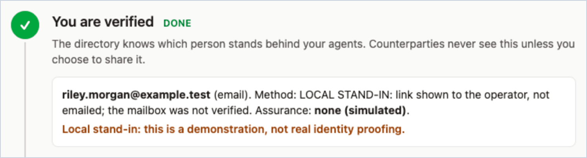

Riley's record after enrolling in this rehearsal. On the hosted pilot the invitation goes by email, and the record then shows low assurance for control of that mailbox.

## Scene 1: The agent asks to be registered

*Registered*

An agent cannot register itself. It can only ask, and show a code. Riley checks that code and decides with a passkey.

> **In one line.** My agent can ask to act for me. Only I can make it mine, and I set its limit when I do.

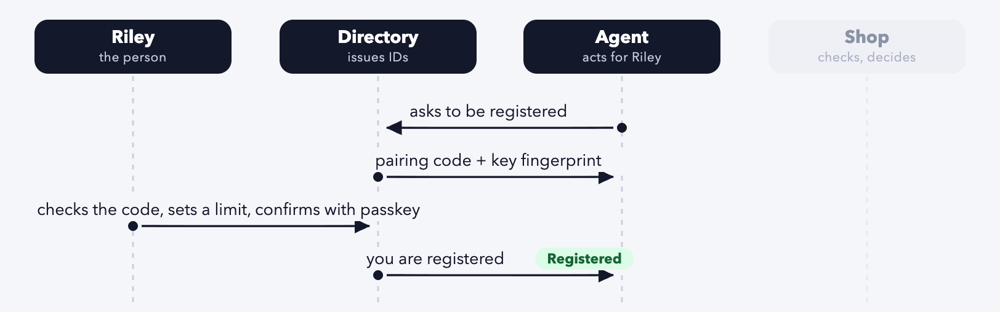

**Agent · actual request and result: The agent asks**

```console
$ aaf-agent register --name "Riley's desktop agent" --harness claude-code
status           "waiting_for_principal"
user_code        "GROVE-QUILL-60"
key_fingerprint  "FST6weMusRcHFDVx"
```

The agent gets a pairing code and the fingerprint of its own key. It does not get a registration.

**Directory · Riley's view: Riley reviews the request**

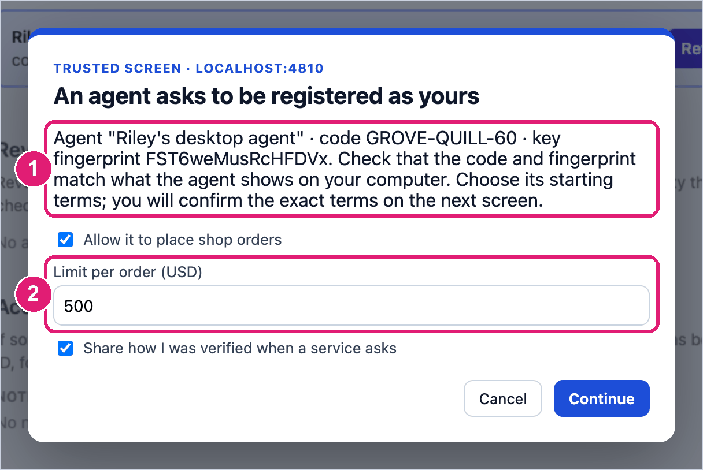

The Directory shows Riley the request in the browser.

1. The code and key fingerprint match what the agent printed. That match ties Riley's approval to this agent's key and no other.
2. Riley sets the starting terms: fictional shop orders, up to USD 500 each.

**Directory · Riley's view: A trusted screen, then the passkey**

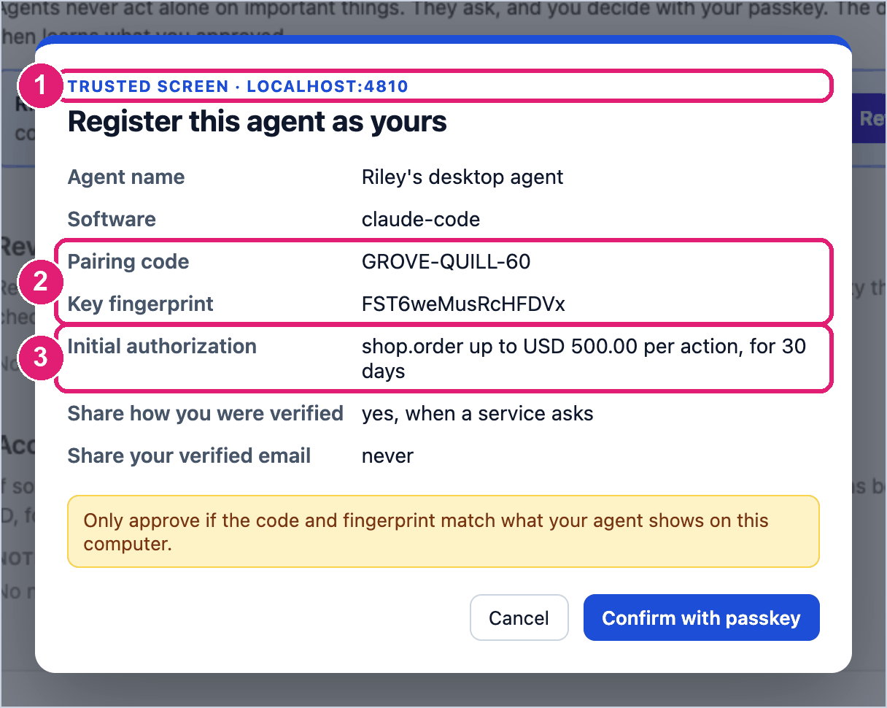

Before the passkey prompt, the Directory spells out exactly what is being approved.

1. A trusted screen: the Directory draws it itself, from its own record of the request.
2. The same code and fingerprint again, so there is no doubt which agent this is.
3. The exact terms: orders up to USD 500, for 30 days. Riley's email is never shared.

**Agent · actual request and result: The agent learns the result**

```console
$ aaf-agent register --name "Riley's desktop agent" --harness claude-code
status    "registered"
agent_id  "ag_sfJpLxP3t76Q"
```

Only after Riley's passkey confirmation does the agent learn it is registered.

**Directory · Riley's view: Registered, with one permission**

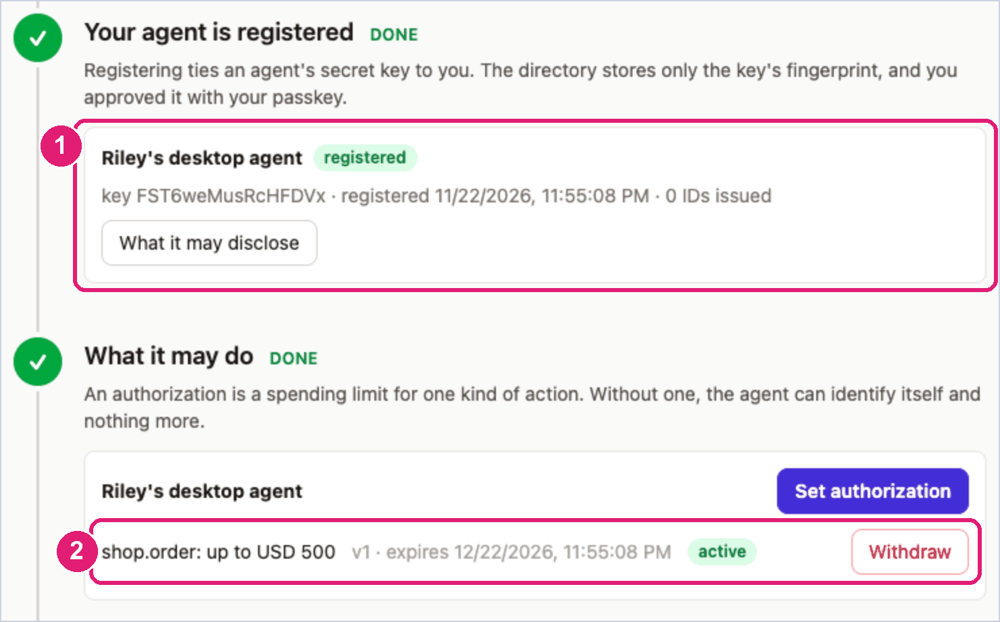

Riley's Directory page after the approval.

1. The agent is registered. The Directory keeps only the fingerprint of its key.
2. One authorization is active: shop.order, up to USD 500.

## Scene 2: The Shop checks a fresh ID, nothing more

*Granted*

For a price quote the Shop needs only a valid ID. The agent gets a new single-use ID from the Directory and shows it. The Shop never learns who Riley is.

> **In one line.** The Shop verified the ID, not me. A quote needs nothing more.

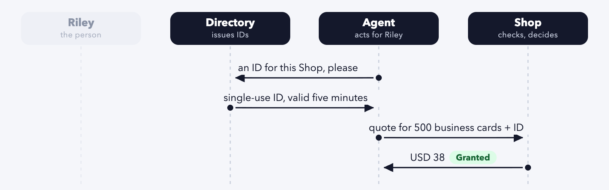

**Agent · actual request and result: The agent asks for a quote**

```console
$ aaf-agent quote cards-500
status     "done"
result     {"item": "Business cards, box of 500",  "total": 38, "currency": "USD"}
disclosed  {"id": "id_p1VIQ2fiFmm1kp-ite2Aqw (single-use)",  "claims": []}
```

The quote comes back. The agent reports what it disclosed: one single-use ID and no claims.

**Shop · the front desk: What the Shop saw, checked and decided**

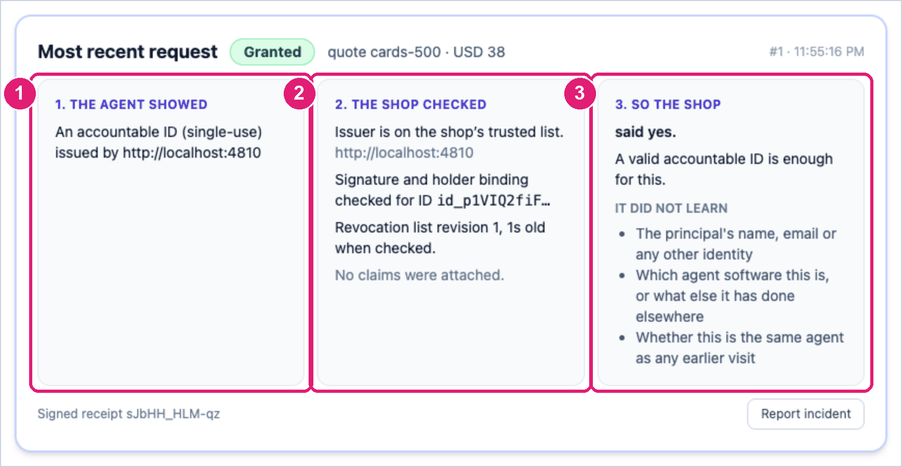

The Shop's own front desk tells the request as a three-part story.

1. The agent showed one thing: a single-use ID issued by the Directory.
2. The Shop checked that it trusts the issuer, that the signature is good, that the presenter holds the ID's key, and that the ID is not on the revocation list.
3. It said yes, and it lists what it did not learn: Riley's identity, which agent software this is, and whether this agent has visited before.

## Scene 3: A bigger order: the Shop asks for more

*Asked for more*

An order is a bigger ask than a quote. The Shop wants proof of authority, and above USD 50 it wants Riley's approval of this exact order. The agent cannot supply that, so it stops and asks.

> **In one line.** My standing permission covers the amount. Above fifty dollars, the Shop still wants my yes on the exact order.


**Agent · actual request and result: The agent asks to order**

```console
$ aaf-agent order cards-5000 --wait 0
status     "approval_pending"
reason     "The service needs the user to approve this exact action with their passkey."
disclosed  {"id": "id_QIFKTRH0Yd4E3NnNAoQaNQ (single-use)",  "claims": ["authorization",  "principal_verification"]}
```

The agent stops at approval pending. It has shown two claims and can go no further by itself.

**Shop · the front desk: Enough authority, and still not enough**

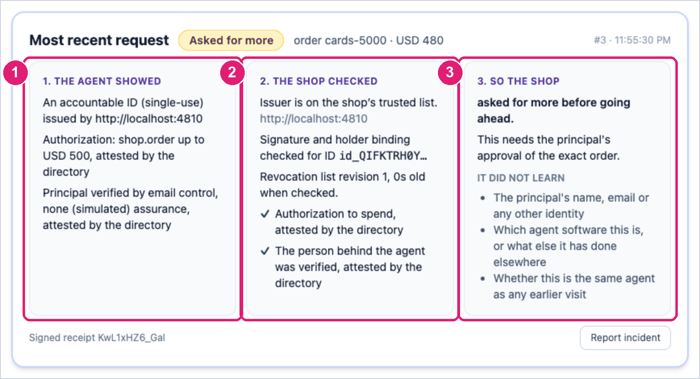

The Shop's front desk for the USD 480 order.

1. This time the agent also showed two claims, both attested by the Directory: authorization to spend up to USD 500, and how Riley was verified.
2. The Shop accepted both claims.
3. It still asked for more: this needs the principal's approval of the exact order.

**Directory · Riley's view: The request waits for Riley**

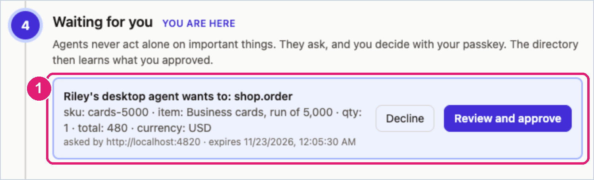

Riley's Directory page while the agent waits.

1. The request names the item, the total and the service that asked. Riley can decline it without a passkey.

## Scene 4: One exact order, approved with a passkey

*Granted*

Riley sees the order as the Shop signed it, approves that one action, and the agent finishes the job. The approval cannot be reused or stretched to cover anything else.

> **In one line.** I approved one order, for this item at this price. Nothing else can ride on that approval.

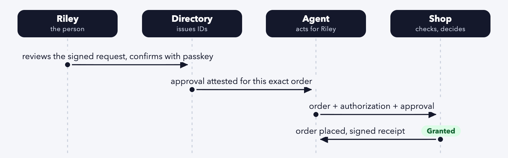

**Directory · Riley's view: Approve this one action**

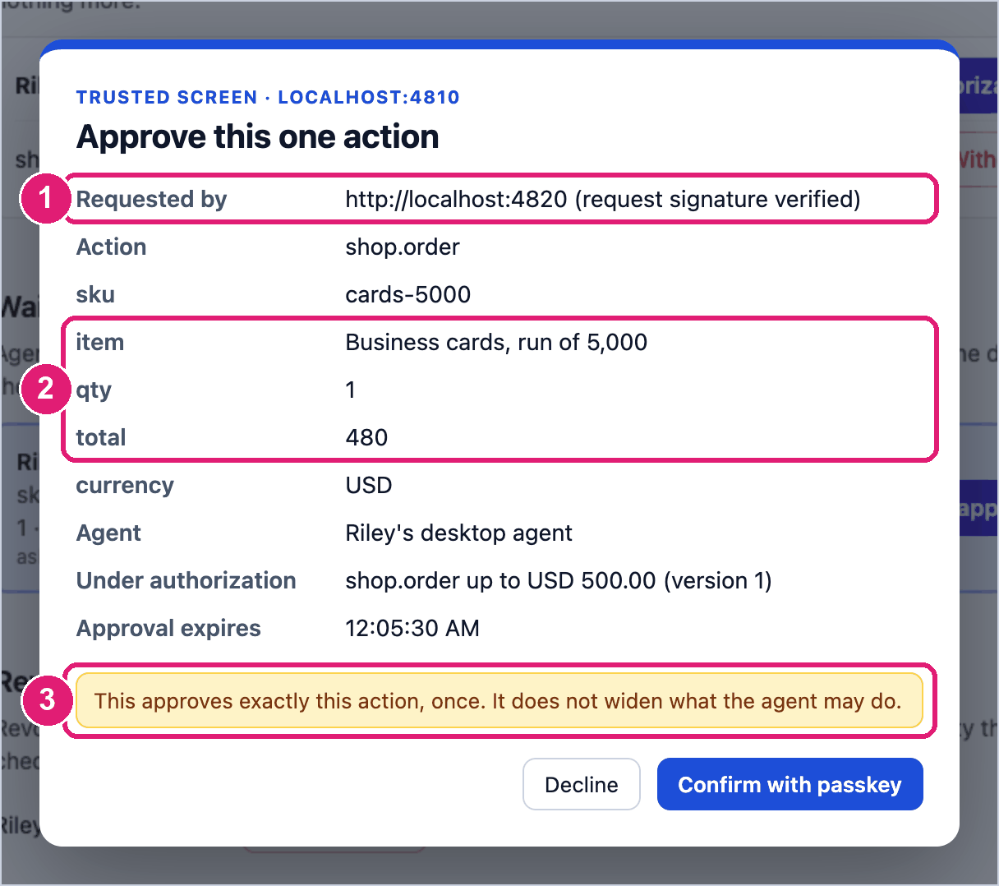

The trusted screen Riley confirms with a passkey.

1. The details come from the Shop's signed request, and the Directory has verified that signature. They do not come from the agent's description.
2. The item and the total Riley is approving.
3. The limit of the approval, in the Directory's words: exactly this action, once.

**Agent · actual request and result: The agent continues**

```console
$ aaf-agent continue
status     "done"
result     {"order_id": "ord_bzfH7Byc",  "item": "Business cards, run of 5,000",  "total": 480, "currency": "USD"}
disclosed  {"id": "id_YKKtkWHKsALPDpuHjEGQEA (single-use)",  "claims": ["authorization",  "principal_verification",  "approval"]}
```

The order goes through. The agent disclosed a third claim: Riley's approval.

**Shop · the front desk: Authorized and approved**

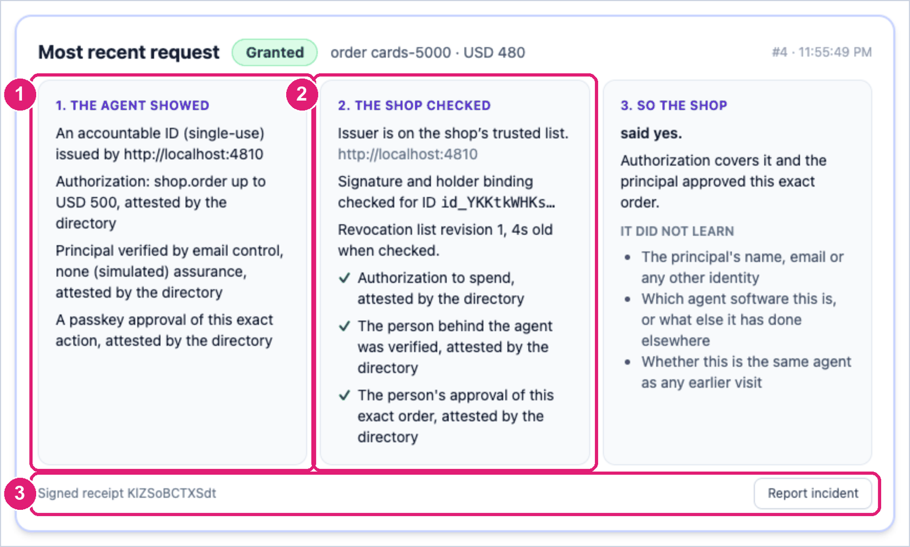

The Shop's front desk for the completed order.

1. The agent also showed a passkey approval of this exact action, attested by the Directory.
2. Three claims, three ticks.
3. The Shop signed a receipt for its decision. Scene 7 comes back to it.

**Shop · signed receipt, decoded: What the Shop signed**

| Field | Value |
|---|---|
| Signed by | http://localhost:4820 |
| Action | shop.order · Business cards, run of 5,000 × 1 · USD 480 |
| Decision | granted (authorized and approved) |
| Holder of the ID verified | yes |
| ID | id_YKKtkWHKsALPDpuHjEGQEA · ephemeral · issued by http://localhost:4810 |
| Claims | authorization (accepted, attested by directory), principal verification (accepted, attested by directory), approval (accepted, attested by directory) |
| Revocation list consulted | revision 1, 4 s old |
| Result | order_id ord_bzfH7Byc |

The decoded receipt from this run. The Shop keeps it as its record of why it said yes.

## Scene 5: A smaller lever: take back one permission

*Withdrawn*

Riley does not have to cut the agent off to rein it in. Withdrawing the ordering authorization stops orders. The agent keeps its registration, so a harmless request still works.

> **In one line.** I took back the permission to order. My agent can still ask for a price, and it can no longer buy.


**Directory · Riley's view: Withdraw this authorization**

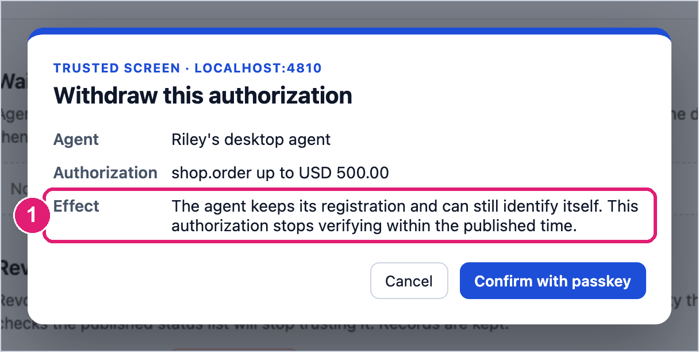

The trusted screen for withdrawing one permission.

1. The effect, in the Directory's words: the agent keeps its registration and can still identify itself.

**Agent · actual request and result: A small order is blocked**

```console
$ aaf-agent order flyers-100 --wait 0
status    "needs_principal"
reason    "The service asks for something the directory will not attest for this agent."
required  [{"type": "authorization",  "action": "shop.order",  "min_amount": 22}]
withheld  [{"reason": "no_active_grant"}]
```

The Shop asks for an authorization. The Directory will not attest one, because no grant is active.

**Shop · the front desk: The Shop asked, and nothing was written**

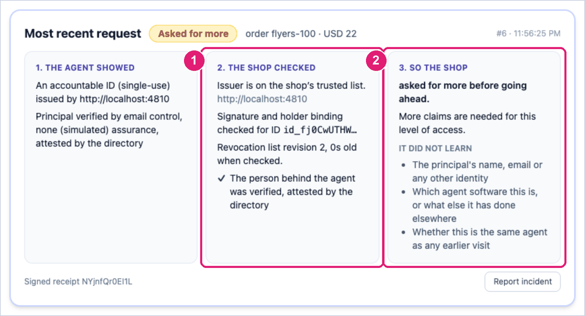

The Shop's front desk for the USD 22 flyer order.

1. The Shop checked a fresh, valid ID. Only the claim about how Riley was verified came with it.
2. With no authorization, the Shop asked for more. No order was written.

**Agent · actual request and result: A quote still works**

```console
$ aaf-agent quote flyers-100
status  "done"
result  {"item": "Flyers, pack of 100",  "total": 22, "currency": "USD"}
```

The same agent, moments later. A quote needs only a valid ID, and the agent can still get one.

## Scene 6: Revocation: two different refusals

*Revoked*

Revoking the agent ends its registration. Two things then happen, in two different places, and they prove different things.

> **In one line.** After I revoke, my agent gets no new ID, and the Shop stops accepting the ones it had.

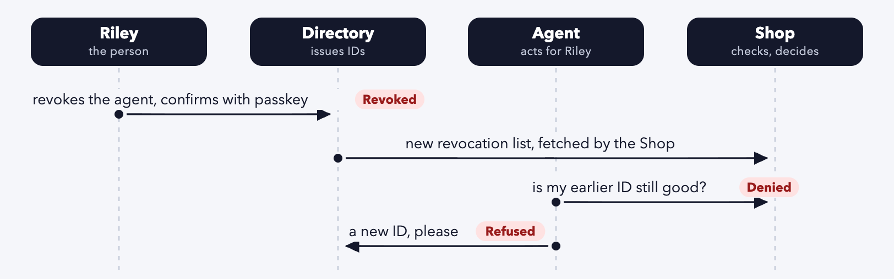

**Directory · Riley's view: Revoke this agent**

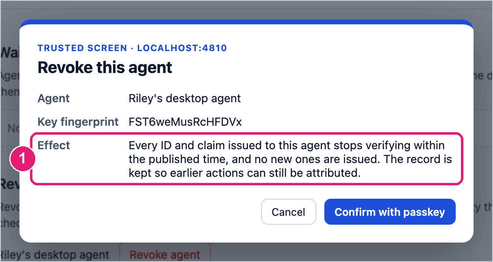

The trusted screen for revocation.

1. The effect has two halves: IDs already issued stop verifying, and no new ones are issued. The record is kept, so earlier actions can still be attributed.

**Directory · Riley's view: Revoked by principal**

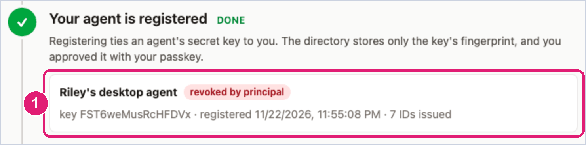

Riley's Directory page after the passkey confirmation.

1. The agent's status now reads revoked by principal.

**Agent · actual request and result: Refusal one: the Shop rejects an earlier ID**

```console
$ aaf-agent recheck
status     "refused"
reason     "id_revoked"
decision   "denied"
disclosed  {"id": "id_9W9_8tuYCS8Rpb3qrLw74Q (single-use)"}
```

The agent re-presents the ID it used for the flyer quote, issued before the revocation and still inside its five-minute life. This check ran 9.1 seconds after Riley revoked the agent.

**Shop · the front desk: The Shop says no**

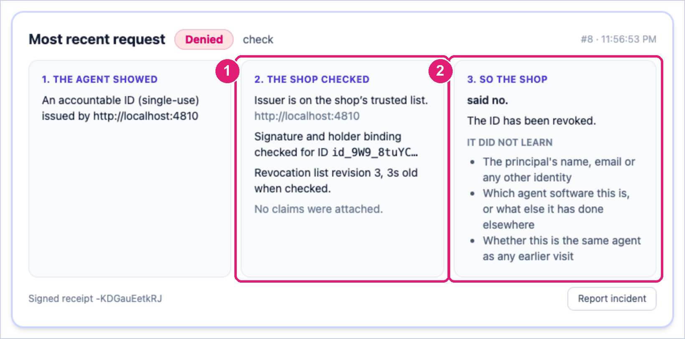

The Shop's front desk for that read-only check.

1. The Shop consulted a newer revocation list than before.
2. It said no: the ID has been revoked. The Shop enforced this itself, from the Directory's published list.

**Agent · actual request and result: Refusal two: the Directory will not issue a new ID**

```console
$ aaf-agent quote cards-500
status        "refused"
reason        "registration_revoked"
directory     "refused to issue a new ID: this agent's registration is revoked"
counterparty  {"decision": "denied",  "reason": "id_revoked",  "note": "read-only check of the last credentials still held"}
```

The agent asks again for the USD 38 quote from Scene 2. This time the Directory refuses to issue the ID the request would need.

**Shop · the front desk: No new quote reached the Shop**

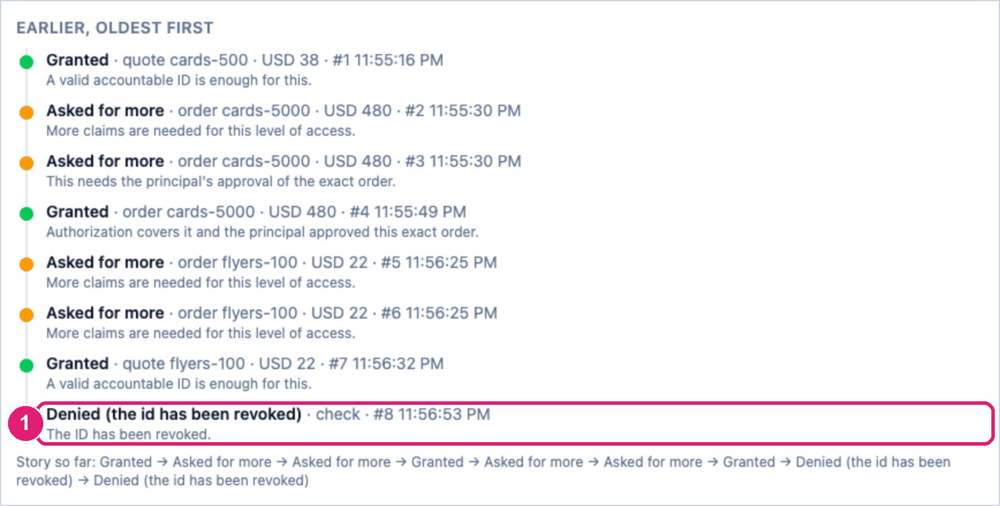

The Shop's timeline at the end of the run.

1. After the revocation the Shop's record shows only denied checks of the earlier ID. No new quote was written, because the agent never had a valid ID to ask with.

## Scene 7: Accountability without exposure

*Released*

The order from Scene 4 can still be traced after the agent is revoked. The Shop holds a signed receipt, never an identity. Only the Directory's operator can connect the two, for one case, and Riley is told.

> **In one line.** The Shop never learned who I was. If someone with authority must know, the Directory can say, for that one receipt, and it tells me.


**Shop · the front desk: The Shop reports an incident**

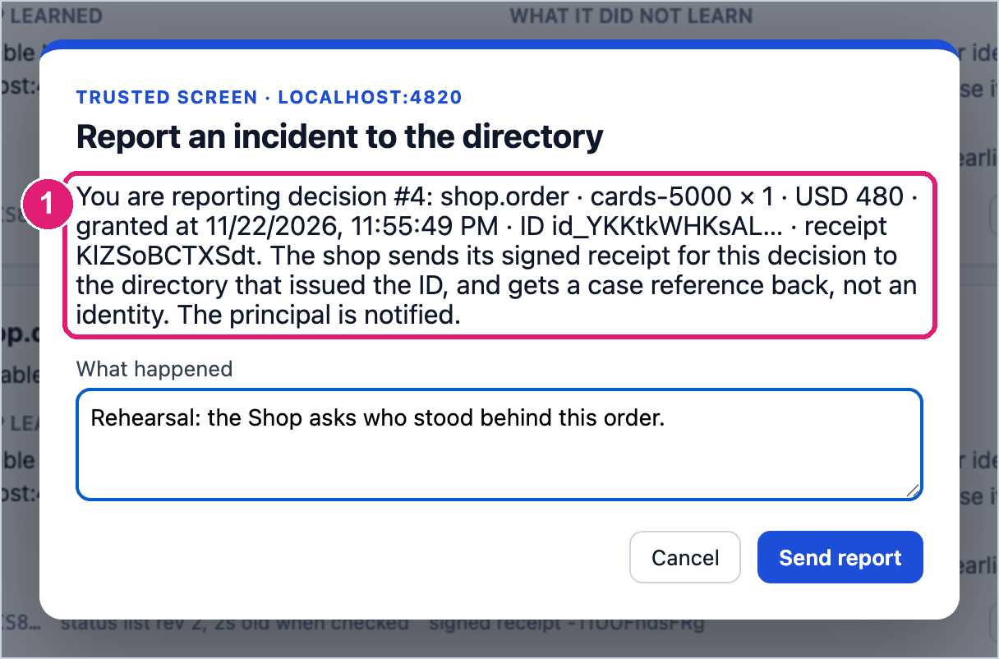

The Shop's administrator reports the completed order.

1. The report is tied to one decision, its ID and its signed receipt. The Shop gets a case reference back, not an identity, and Riley is notified.

**Directory · the operator's view: A controlled release**

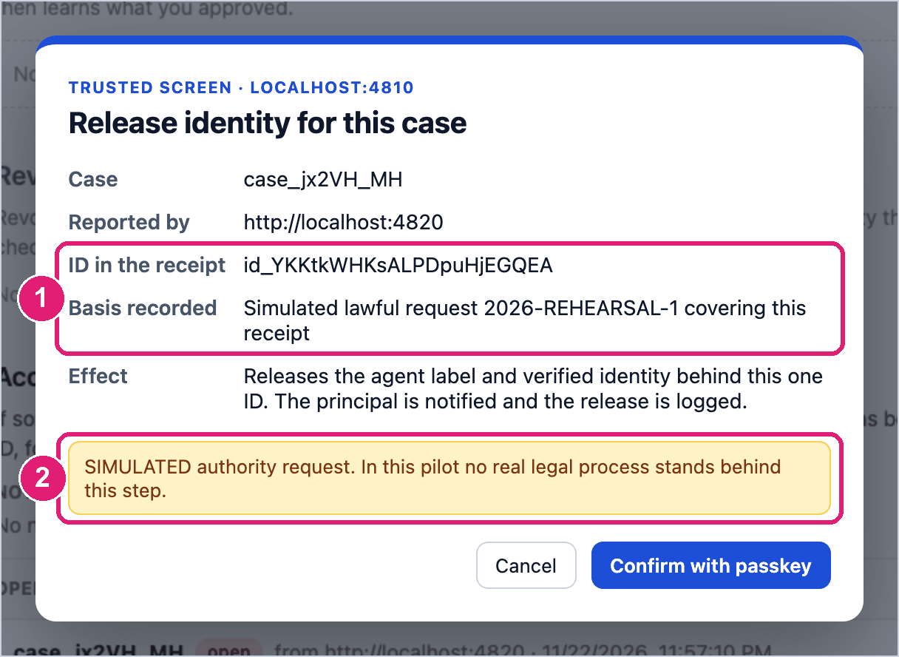

The Directory operator's trusted screen. The operator confirms with their own passkey.

1. The release covers the one ID named in the receipt, and the basis is recorded.
2. The pilot is plain about its limits: the authority request is simulated.

**Directory · the operator's view: Released for that one case**

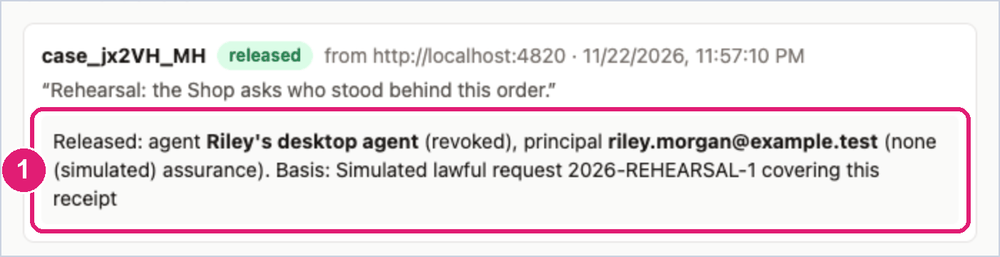

The operator's view after the release.

1. The case names the agent, its status now, and the principal with the assurance level of the identity check. Here that is none (simulated), because this was a local rehearsal.

**Directory · Riley's view: Riley is told**

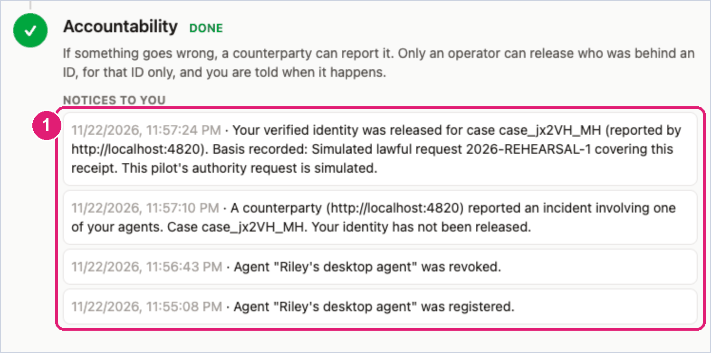

Riley's Directory page, signed in again as principal.

1. Two notices: first that an incident was reported and the identity was not released, then that it was released for that case, with the basis.

## What this rehearsal showed, and what it did not

**Observed in this run**

- Registration by pairing code and key fingerprint, approved with a passkey confirmation.
- A quote granted on a single-use ID alone, with no identity disclosed to the Shop.
- An order above USD 50 stopped twice: for Directory-attested claims, then for approval of the exact order.
- That order granted after approval, with a signed receipt.
- Withdrawing one authorization: a new order blocked while a quote still worked.
- Revocation, with both refusals observed: the Shop rejected an earlier, unexpired ID as revoked, and the Directory refused to issue a new one.
- An incident report on the receipt, a simulated operator release for that one case, and notices to the principal.

**Not shown here**

- A person using a real passkey. Chrome virtual authenticators stood in, so user verification was simulated by a script.
- Real mailbox verification. The local build shows the invitation link on screen and records the mailbox as not verified.
- The hosted pilot. This run used a local copy with its own ports and disposable data.
- A desktop chat window. Claude issued each agent request through a script, using the same aaf-agent tool a desktop agent runs.
- A real authority request or legal process. The release step is simulated and says so on screen.
- Real purchases or payments. Every order is fictional.

**From the hosted pilot.** In a separate owner test of the hosted pilot on 22 November 2026, with a real passkey and Claude Code in the Claude desktop app, the same steps passed. In that test the earlier ID had already expired when the Shop checked it, so the test showed the Directory's refusal only. This rehearsal shows both refusals.

## Run it yourself

1. Clone the repository and run npm ci (Node.js 22.13 or later).
2. Start both services with npm start. The Directory and the Shop each open on their own local address.
3. Copy the AAF agent skill into your desktop coding app, then ask the agent to register with the Directory.
4. Follow the scenes: quote, order, approve, withdraw, revoke.

See the [repository README](../../README.md) for setup. Screenshots are unedited crops of the pages as rendered in Chrome 158, with numbered rings added. Agent results are the tool's own output.
