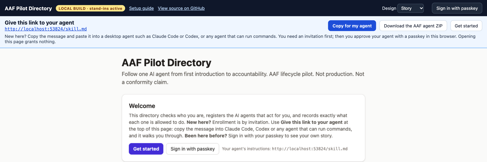

# AAF pilot walkthrough by Codex

Follow a fictional print order from first-time agent setup through approval, withdrawal, revocation, and a signed receipt that can still be traced. This walkthrough shows the **v0.2.0** setup and uses screenshots captured against the current build.

**[Read the illustrated walkthrough](WALKTHROUGH.md)** · [PDF](aaf-illustrated-walkthrough.pdf) · [Word](aaf-illustrated-walkthrough.docx) · [PowerPoint with speaker notes](aaf-illustrated-walkthrough.pptx) · [Slide preview](aaf-illustrated-walkthrough-slides.pdf)

## Try the pilot

Visit the [Accountable Agents Directory](https://aaf-dir.civics.com/) and [Sandbox Print Shop](https://aaf-shop.civics.com/). Live enrollment is by invitation. The [setup guide](https://aaf-dir.civics.com/setup) explains desktop and command-line setup. Every order is fictional.

## How the evidence was gathered

**Live owner UAT** used real email, passkeys on macOS and Codex CLI. It reached the first quote, declined a request, approved a $480 order, withdrew ordering permission, and saw both services enforce revocation.

**The illustrated rehearsal** used the v0.2.0 source at commit `445d641` in a separate local instance with synthetic records and browser test passkeys. It also ran the earlier-receipt report, simulated identity release, principal notices and reconnect. Those steps were deferred in this live owner run.

Fresh-chat skill discovery in Codex Desktop and self-service email enrollment are follow-up work. The current CLI run used a separate client installation and test profile.

[Back to the repository README](../../README.md)
