# Accountable Agents Framework illustrated walkthrough

**Codex walkthrough · v0.2.0 · November 23, 2026**

A person gives an agent permission to act in the Directory. The separately hosted Sandbox Print Shop checks the agent’s credentials and asks for stronger approval as needed. The person can withdraw authority or end the registration.

The screens below are from an isolated run of the v0.2.0 source at `445d641` with synthetic accounts and browser test passkeys. The separate owner UAT used real email, passkeys and Codex CLI on the hosted pilot. Individual scenes identify evidence unique to either run. Every order is fictional.

**[Live Directory](https://aaf-dir.civics.com/)** · [Setup guide](https://aaf-dir.civics.com/setup) · [Sandbox Print Shop](https://aaf-shop.civics.com/) · [Download formats](README.md)

## 1. Start at the live Directory

*Directory and setup guide*

The homepage gives the person a setup guide and a message to copy for their agent. The live pilot uses invitations.

Story and Console are available before sign-in. Sample data belongs to the signed-in Directory operator. The setup guide covers desktop agents and a direct command-line path from the same versioned ZIP.

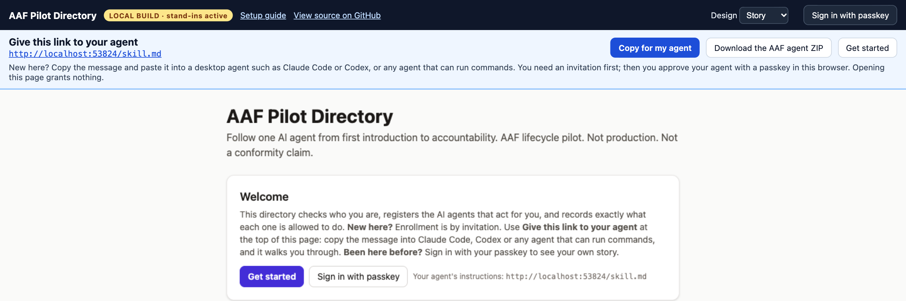

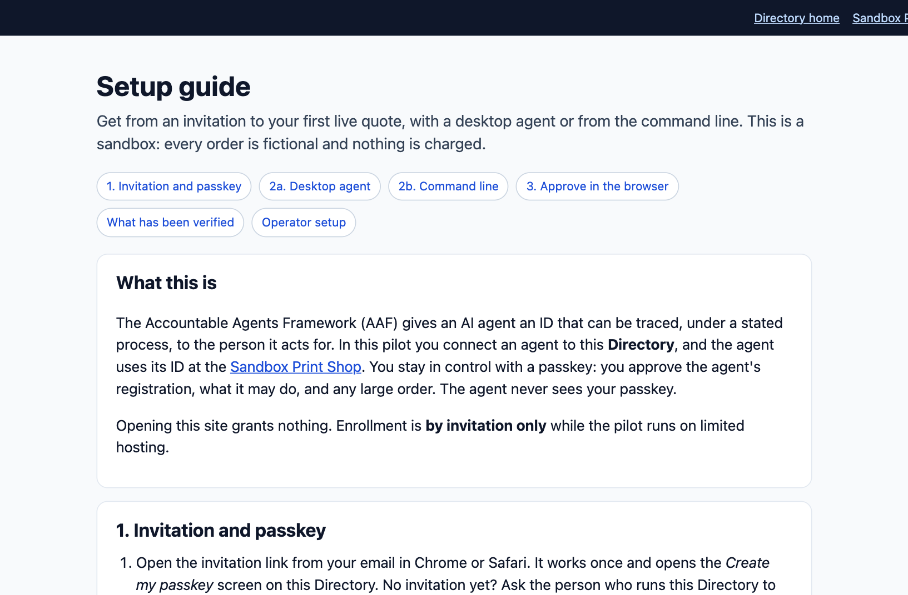

**What this shows.** Public email signup with capacity limits is proposed for a later release. The operator invites new testers in v0.2.0.

## 2. Invite a person and create a passkey

*Operator and principal*

The operator reviews the destination mailbox and confirms with their passkey. The emailed link is single-use and expires after 48 hours.

The person opens the link and creates their own passkey. The page explains how to save it as a new password-manager entry. The live owner received the email within seconds after confirming the send and made a new 1Password entry.

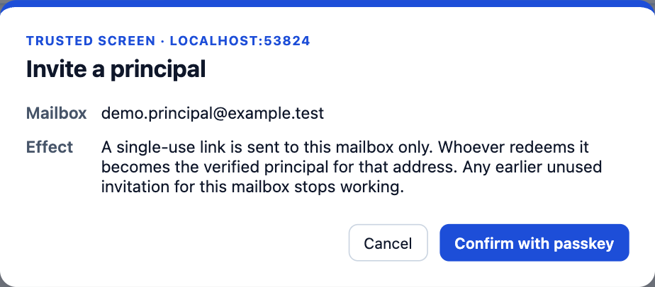

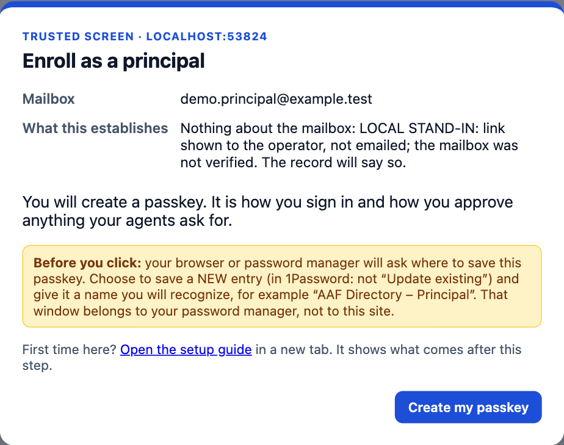

**What this shows.** These screens use a local invitation and test passkeys. Live enrollment verified control of the invited mailbox.

## 3. Connect the agent to this account

*Agent and Directory*

After sign-in, Copy for my agent tells the agent that the person has enrolled. The shared setup skill has no account secret in it.

The agent generates its own key and supplies the pairing code and fingerprint. The person checks both values and confirms in the same browser session in which they are signed in as the principal.

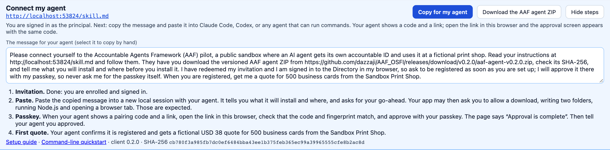

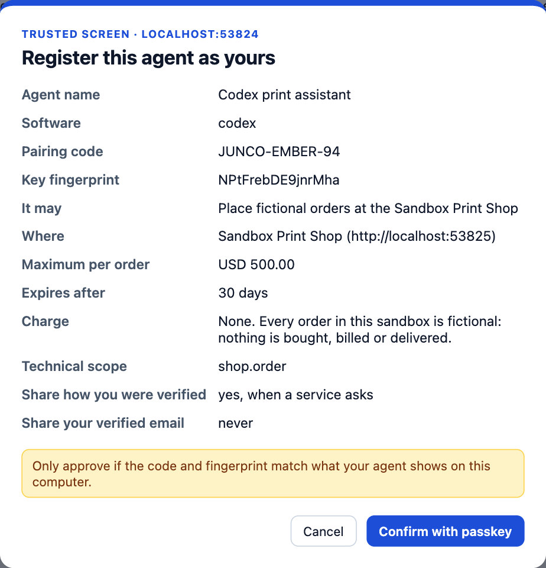

**What this shows.** Passkey approval links the agent’s public key to the signed-in account. The Directory stores the public key and fingerprint. The agent keeps the private key.

## 4. A quote needs a valid agent ID

*Sandbox Print Shop*

The Shop returns a fictional $38 quote for 500 business cards. The agent presents a short-lived, single-use ID.

The Shop checks the Directory signature, the holder’s proof and the published revocation status. The live CLI run sent zero claims with this quote.

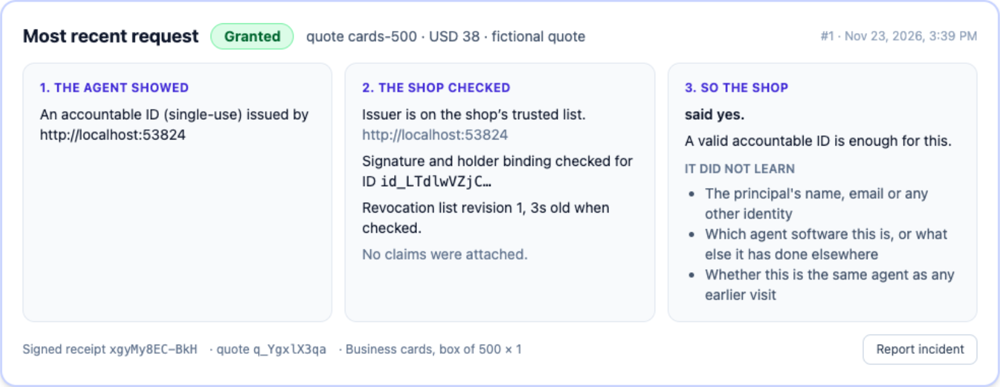

**What this shows.** The Shop received no ordering authorization, passkey approval, or principal email for the quote.

## 5. The person can decline an order

*Directory*

Ten boxes of 500 cards cost $380. A single run of 5,000 costs $480. The catalog offers both package options.

The person uses Decline on the review screen for the ten-box request. The local rehearsal confirmed the decline and created no order. In live UAT the CLI still showed the declined request as pending locally.

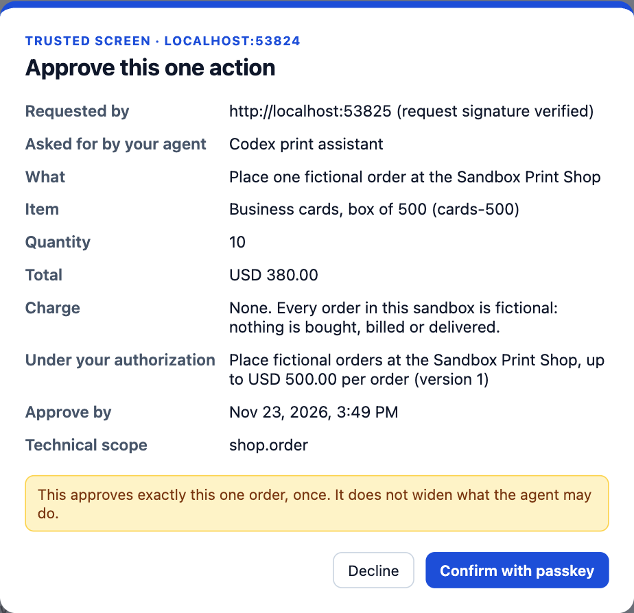

**What this shows.** Compare the listing, packaging, quantity and total. The catalog supplies no evidence about quality or turnaround differences.

## 6. Approve one exact fictional order

*Directory and agent*

The Shop asks for the principal’s passkey approval of the $480 print run even though the standing $500 authorization covers the amount.

The trusted screen shows the requester, Shop, item, total, deadline and no charge. The local rehearsal forces a passkey check to expire, then uses Try passkey again while the order request is still valid.

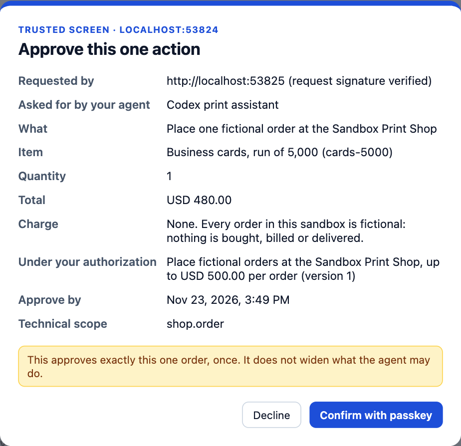

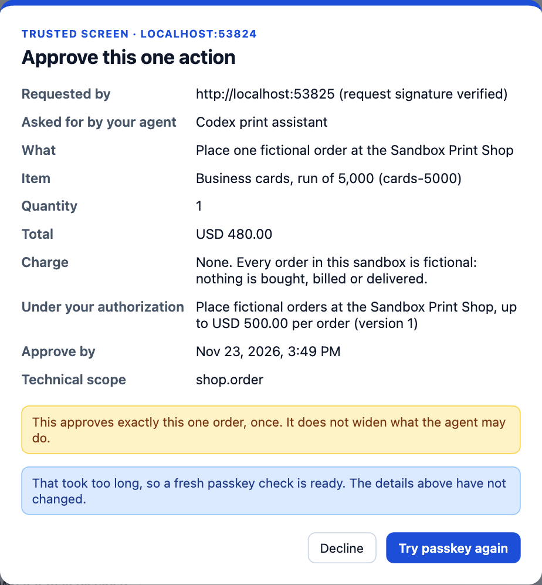

**What this shows.** Once the page says Approval is complete, the agent resumes that exact request. Early delivery of the approval link is still a UAT improvement.

## 7. The Shop signs the result

*Sandbox Print Shop*

The Shop completes the fictional order and signs its decision receipt. The client checks the receipt before reporting the result.

This transaction uses a single-use agent ID and three accepted claims. They cover ordering authority, how the Directory verified the account holder, and approval of this particular order.

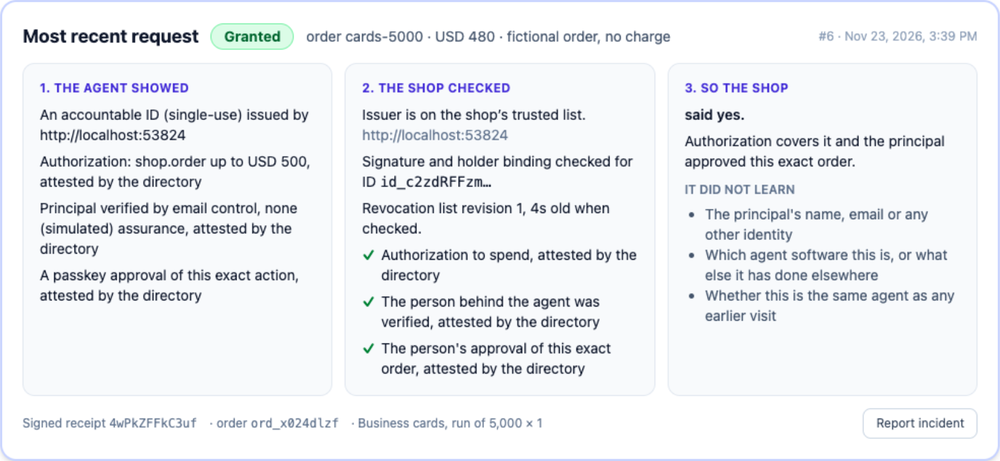

**What this shows.** The Shop can verify permission and exact approval without receiving the principal’s email.

## 8. Withdraw the power to order

*Directory and Sandbox Print Shop*

The principal withdraws the $500 order authorization with a passkey. The agent stays registered.

The Shop blocks a $22 order for a pack of flyers because the active authorization is gone. A quote for the same pack still works on a valid ID.

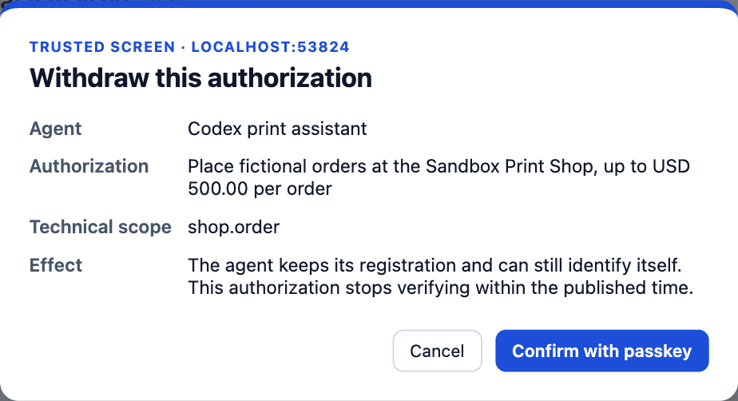

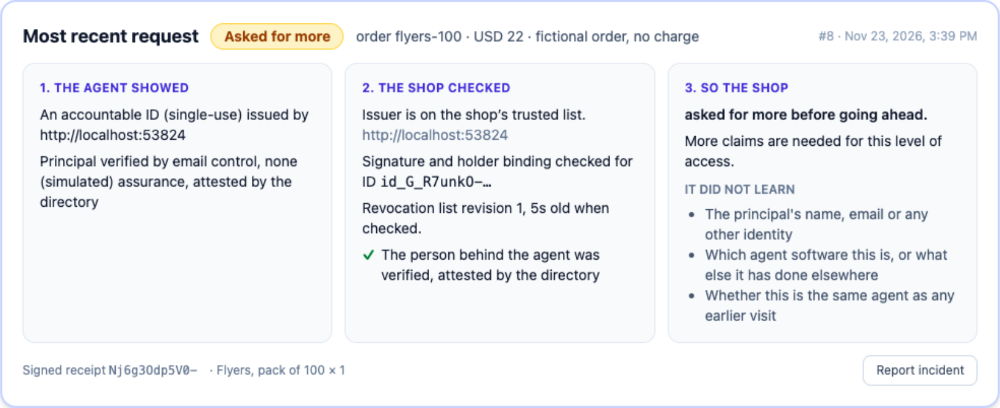

**What this shows.** Withdrawing the grant removes ordering authority while leaving basic identification and quotes available.

## 9. Revocation stops fresh credentials

*Directory and Sandbox Print Shop*

The person revokes the agent. The Directory refuses a new ID, and the Shop rejects the last-issued, unexpired ID as revoked.

In live UAT the person asked for 150 flyers. The smallest option was two whole packs of 100 at a $44 catalog price. The request produced no fresh quote. The public catalog remained available.

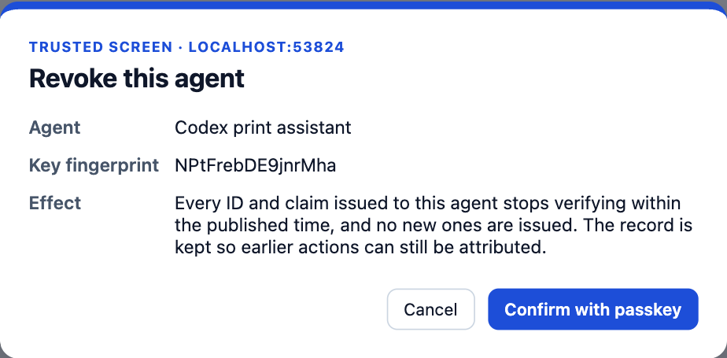

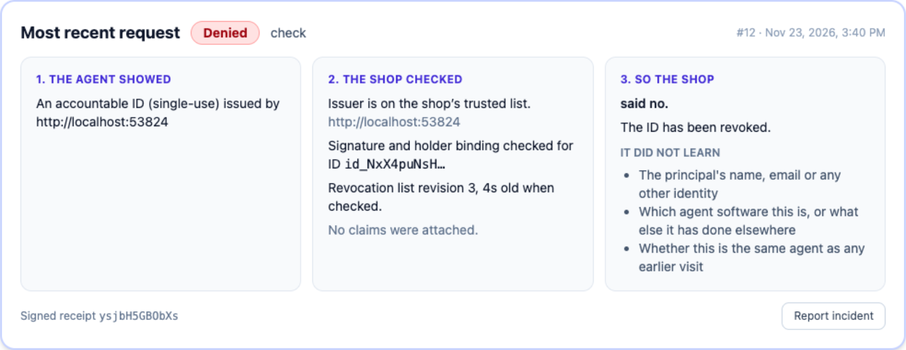

**What this shows.** The two refusals demonstrate separate controls. The Directory blocks issuance and the Shop enforces the published status of an earlier ID.

## 10. Report an earlier signed receipt

*Shop administrator*

After newer activity appears, the Shop administrator opens the earlier $480 receipt from the Story view.

The earlier receipt identifies the exact decision and signed evidence. The Shop sends a report for that receipt and receives a case reference.

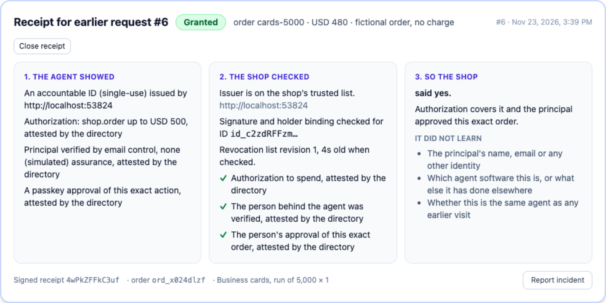

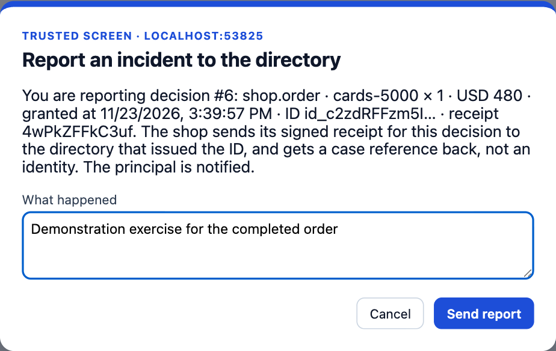

**What this shows.** This scene was exercised in the isolated rehearsal. The owner paused live UAT before sending the report.

## 11. Resolve the case and notify the person

*Directory operator and principal*

For a simulated authority request, the operator records a reason and uses a passkey to release identity for the ID in that one receipt.

The case can be traced after revocation. The principal sees both the incident-report notice and the scoped simulated release notice.

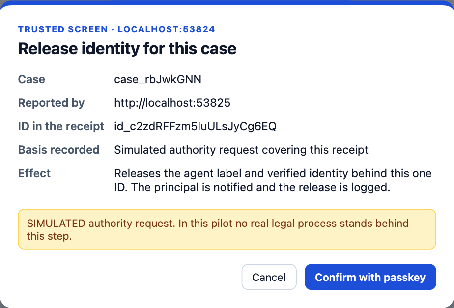

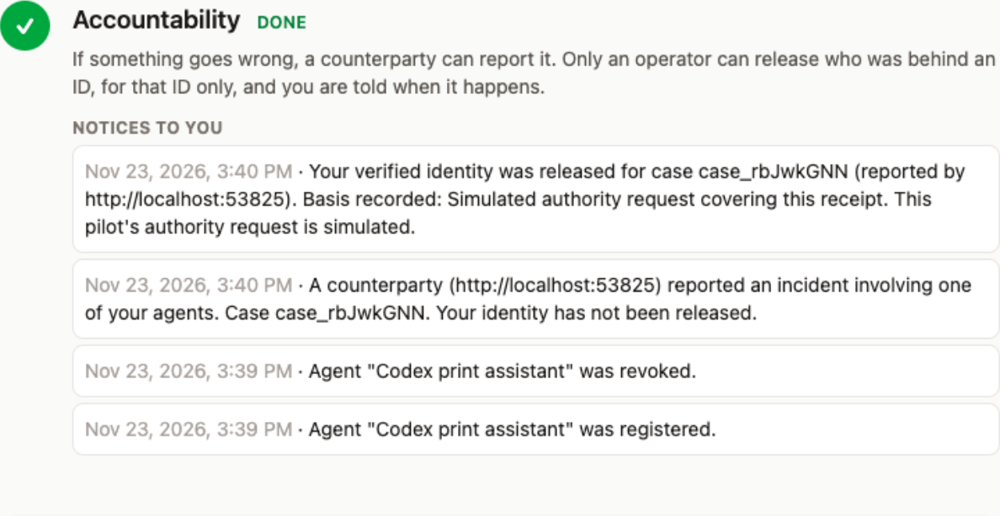

**What this shows.** The local run verified the case and notices. The live owner run paused before this part of the accountability flow.

## 12. Reconnect with a new registration

*Agent and Directory*

A previously revoked registration stays revoked. Connecting again starts a new pairing and requires a new principal approval.

The isolated client moved the old identity aside, connected a new one, and got a fresh quote. The live owner run left reconnection for later.

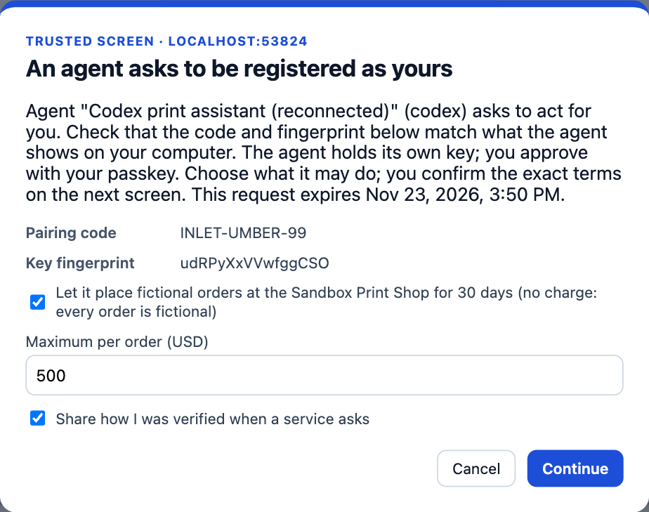

**What this shows.** The current client can finish a live run in one Codex CLI session. A discoverable skill and the same registration in a second Codex Desktop chat are still pending UAT.

## What to know before testing

- **Operator role.** A signed-in Directory operator can switch to a sample dataset. Signed-out visitors, principals, and hosted Shop viewers stay on Live. Switching between Story and Console keeps the current data. The source link is available before sign-in on both sites.
- **First-time desktop and CLI setup.** The setup guide points to the same versioned ZIP for both. A live Codex CLI session verified the release checksum and completed registration and a quote. Separate headless staging runs exercised Claude Code and Codex. The native desktop apps’ permission prompts and a second Codex Desktop chat still need owner UAT.
- **Codex skill durability.** A client working in one workspace can still be invisible to a fresh chat. A prior skill may also point to older checkout-specific instructions. Use the current release and preserve the separate agent profile during upgrades.
- **Availability.** The hosted pilot currently uses operator invitations. Self-service email requests, enrollment quotas and a signup pause are proposed follow-up work.

## Evidence summary

| Verified in the live owner run | Verified in the isolated rehearsal |
| --- | --- |
| Real invitation email and separate passkey entry | Local invitation and browser test passkeys |
| Codex CLI pairing and $38 quote | Pairing and quote through an isolated agent profile |
| Decline, exact $480 approval and signed Shop receipt | Decline result and fresh passkey challenge after a forced local expiry |
| Blocked order after withdrawal, with quotes still available | Both withdrawal outcomes |
| Directory refusal of a new ID and Shop rejection of the earlier ID as revoked | Both revocation outcomes, earlier Story receipt, simulated case release and principal notices, and a new registration |

[Back to the demo overview](README.md)
